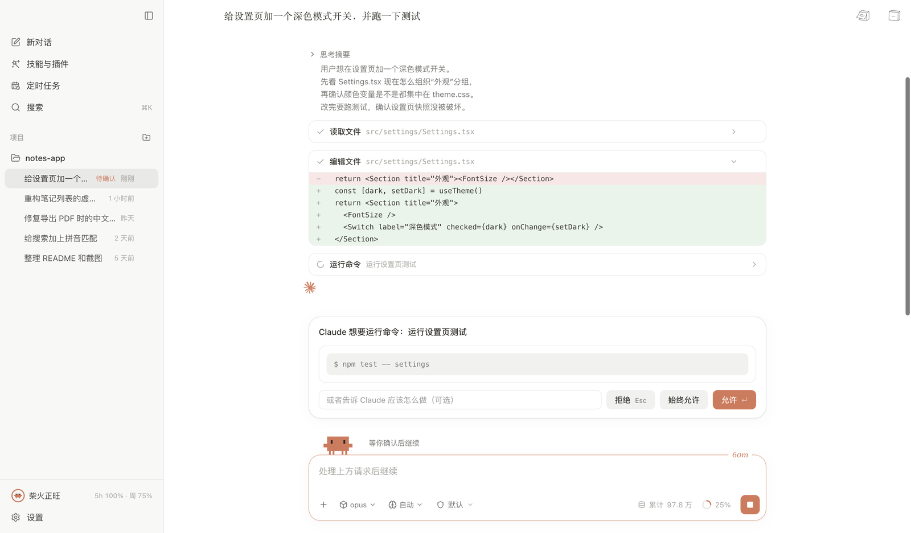
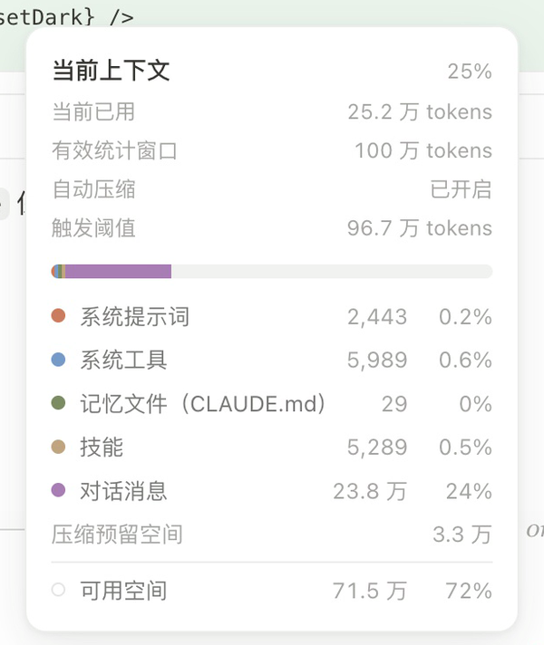

# Claude Code for Mac

基于 Electron、React 和 Claude Agent SDK 构建的第三方 macOS 桌面客户端，提供中文界面。此项目不是 Anthropic 官方桌面应用。



## 下载和安装

在 [Releases](https://github.com/Link557/Claude-Code-for-Mac/releases) 下载最新版本。

- `Claude-Code-for-Mac-0.3.51-arm64.dmg`：打开后将 `Claude Code.app` 拖到 Applications。
- `Claude-Code-for-Mac-0.3.51-arm64.zip`：解压后得到同一个应用。
- `SHA256SUMS.txt`：安装包 SHA-256 校验值。

当前提供 **Apple Silicon（arm64）** 版本，不支持 Intel Mac。桌面应用使用 ad-hoc 签名，未获 Apple 公证。本机 Gatekeeper 默认检查结果为 `rejected`，通过浏览器下载后，macOS 可能拦截首次打开。

首次使用需要在本机配置有效的 Claude Code 登录或 API 认证。安装包不包含账号、API Key 或聊天记录。

各版本改动见 [更新记录](CHANGELOG.md)。

## 设计小巧思

### 输入框上的小螃蟹

螃蟹站在输入框上方，用动作和一句短文案告诉你 Claude 在做什么。工作时每 8 秒换一个随机动词，7 种动作随动词切换：思考、烹煮、制作、整理、生长、探索、玩心。等待确认时停下来等你，空闲 30 秒后睡着；新建会话页上还可以把它拎起来，松手会落回原位。


动作只是陪伴，与具体工具无关；读取文件、运行命令等真实状态写在旁边的文字里。

### 缓存倒计时

输入框右上角显示提示缓存还剩几分钟。缓存从最近一次主对话请求起算，按实际写入的档位（5 分钟或 1 小时）计时，过期后数字和边框变灰。看一眼就知道现在发消息能不能命中缓存。

| 缓存有效 | 已过期 |
|---|---|
|  |  |

### 上下文一目了然

输入框右下角的圆环是上下文占用，悬停展开明细：已用量、统计窗口、自动压缩阈值、各部分占比、压缩预留空间和剩余可用空间。



### 剩余额度螃蟹

侧栏左下角用一只螃蟹同时表示两种额度：**外圈是 5 小时额度，螃蟹身体里的填充是本周额度**。旁边的文案把 5 小时额度比作灶里的火、周额度比作柴堆，一眼读出哪边快用完了。


### 侧栏页数 I–VI

每个会话的右侧栏最多同时打开 **6 页**，文件预览、终端、浏览器、聊天和摘要共用这个上限，满额后不会自动关闭最早的页面。收起侧栏时用罗马数字 **I–VI** 表示页数，六种柔和配色借用希腊神话意象；数量不只依靠颜色区分，深色主题使用同色系的较亮版本。

| 页数 | 配色 | 意象 |
|---|---|---|
| I | 陶土橙 `#B96D4F` | 赫斯提亚的炉火 |
| II | 橄榄绿 `#71805A` | 雅典娜的橄榄树 |
| III | 海蓝 `#487D96` | 波塞冬的海洋 |
| IV | 古金 `#A68538` | 阿波罗的光辉 |
| V | 玫瑰色 `#AD7187` | 阿佛洛狄忒的爱与美 |
| VI | 葡萄紫 `#826394` | 狄俄尼索斯的葡萄酒 |

这是现代配色，并非古代规定的对应关系。意象参考 [Theoi Greek Mythology](https://www.theoi.com/greek-mythology/olympian-gods.html)。

### 每一步都摊开

- 思考摘要按实际顺序穿插在回复和工具调用之间，默认显示最新三行，只展示 SDK 实际返回的文字。
- 编辑文件直接展开 diff，运行命令前弹出确认卡，可以拒绝、允许或始终允许。
- 橙色 Spark 动效跟随输出收缩舒展；等待确认、停止、完成或减少动态效果时保持静态。
- 会话摘要面板汇总文件变更、来源、任务和子 Agent，数据来自工具调用和 SDK 事件，不额外调用模型。

## 功能

- 项目管理、历史会话、流式回复、权限确认、模型和思考程度选择。
- 输入 `/` 立即显示常用命令，项目命令在后台加载，逐字过滤在本地完成。
- 右侧栏：工作区文件、终端、浏览器和侧边聊天。文件支持代码、Markdown、图片、HTML、PDF、DOCX、Excel 内嵌预览。
- 多个独立侧边聊天，分别保存草稿和问答；`/btw` 每次创建独立聊天页。
- 后台任务列表：查看输出、停止任务和子代理进度。
- 浅色和深色主题，侧栏调宽与展开动效。

<details>
<summary>使用说明与边界</summary>

右侧栏仅在会话内开放，标签和展开状态按会话隔离；加号新建“开始”页。归档当前会话后返回主页。思考摘要可展开查看本轮完整返回内容。摘要面板底部的“查看全部”打开完整会话摘要标签。

会话摘要面板直接来自工具调用、SDK 任务事件与目录 Hooks，不额外调用模型。变更行数表示已确认文件工具操作的累计值，不是仓库净差异；缺少可靠补丁时显示未知，通过终端或外部程序产生的改动可能未覆盖。旧会话缺失的生命周期事件不会被猜测补齐。摘要分类仅在有记录时显示，默认折叠，展开后最多预览三条。

思考摘要只展示 SDK 实际返回的文字，不额外调用模型生成或补写。部分模型或供应商可能不返回正文。侧边聊天接口只返回最终答案，因此等待时仅显示工作动效。

应用将精简活动记录保存在用户数据目录的 `session-activity/`，以便重启后恢复摘要。不会复制完整工具参数或工具返回正文。

HTML 和 DOCX 预览不执行脚本，也不加载文档中的远程资源。Office 预览只读，不保证完整还原排版或图表，不执行宏或重新计算公式。PDF 支持密码输入，预览上限 100 MB；Excel 支持工作表切换与大表按可见区域渲染，Office 文件上限 30 MB；超限或不支持的文件可用系统默认应用打开。

macOS 红色关闭按钮和 `Command-W` 仅隐藏窗口，聊天、草稿、终端和浏览器继续保留。点击 Dock 图标或再次打开应用可恢复原窗口；`Command-Q`、应用菜单或 Dock 的退出操作才会退出应用并清理资源。

切换会话、返回主页、归档或进入设置时，会保留终端进程与浏览器页面；关闭标签、移除所属项目或退出应用时释放资源。侧栏标签、草稿和侧边聊天仅在本次应用运行期间保留，重启后不会恢复。

命令目录成功加载后保存在用户数据目录的 `command-catalog/`。超过五分钟后在下次使用时后台刷新，已有会话的命令变化也会更新目录。首次发现的项目自定义命令仍需等待 SDK 初始化；常用命令和缓存目录不受该等待影响。

应用设置存放在 `~/Library/Application Support/claude-desk`，不属于源码仓库或 Release 附件。

</details>

## 项目结构

```text
Claude-Code-for-Mac
├── src
│   ├── main/                Electron 主进程
│   │   ├── live/            运行中的会话、回合活动与会话调度
│   │   ├── ipc/             IPC 注册与参数校验
│   │   ├── sdk.ts           Claude Agent SDK 接入
│   │   └── transcript.ts    SDK 事件 → 界面消息
│   ├── preload/             经过隔离的 IPC 桥接
│   ├── renderer/            React 界面与状态管理
│   │   ├── components/
│   │   │   ├── chat/        对话流、思考摘要、工具卡片、确认卡、上下文占用
│   │   │   ├── newSession/  输入框、小螃蟹、模型与模式选择
│   │   │   ├── right/       右侧栏：文件、终端、浏览器、侧边聊天、后台任务
│   │   │   ├── summary/     会话摘要面板
│   │   │   ├── usage/       剩余额度螃蟹与用量统计
│   │   │   └── …            sidebar · settings · skills · schedules · dialogs · ui
│   │   ├── motion/          开屏与首条消息动效
│   │   └── styles/          主题与配色
│   └── shared/              主进程与界面共用：IPC 契约、缓存计时、额度文案等
├── test/                    单元测试与交互测试（样例路径已替换为示例路径）
├── scripts/                 构建安装、原生模块和界面验证脚本
├── design/                  设计稿；promo/ 是宣传片流水线，readme/ 生成本页配图
└── docs/                    代码审查记录、设计素材与 README 配图
```

## 本地开发

建议使用 Node.js 24 LTS（24.15.0 或更高的 24.x 版本）。编译终端原生模块需要 Xcode Command Line Tools。

```sh
npm ci
npm run dev
```

依赖安装后会自动为 Electron 重建 `node-pty`。更换 Electron 版本后可执行 `npm run rebuild-native`。

每次修改都先记录在 `.local/CHANGELOG.md`，包含版本、改动、验证和本地安装结果，作为后续整理 README 与发布说明的依据。该目录已由 `.gitignore` 排除，不提交或推送到 GitHub。

## 检查与构建

```sh
npm run typecheck
npm test
npm run build
npx electron-builder --mac dir --arm64
```

生成的应用位于 `dist/mac-arm64/Claude Code.app`。生成 Release 安装包：

```sh
npx electron-builder --mac dmg zip --arm64 --publish never '-c.artifactName=Claude-Code-for-Mac-${version}-${arch}.${ext}'
```

<details>
<summary>界面集成验证</summary>

以下验证使用临时项目和合成会话，不发送 Claude 对话。

```sh
npm run build
env -u ELECTRON_RUN_AS_NODE node_modules/.bin/electron scripts/smoke-sidebar.cjs    # 界面与工作区集成
env -u ELECTRON_RUN_AS_NODE node_modules/.bin/electron scripts/smoke-summary.cjs    # 会话摘要（合成 SDK 事件）
env -u ELECTRON_RUN_AS_NODE node_modules/.bin/electron scripts/smoke-thinking.cjs   # 思考动效与摘要流
node scripts/smoke-window.cjs                                                       # 命令响应与窗口生命周期，含退出后 PTY 进程检查
```

覆盖会话隔离、归档导航、侧边聊天、DOCX/Excel/PDF 文件预览、终端和本地浏览器。Office 样本在运行时生成；PDF 样本可通过 `scripts/generate-pdf-fixtures.py` 重新生成（需要 Python 的 reportlab、pypdf）。`npm run probe` 会实际调用模型，应按需要手动运行。

README 配图由 `design/readme/shots.cjs` 生成：界面截图取自宣传片录制的演示数据，额度螃蟹由真实组件渲染。

</details>

## 开源许可

本项目原创源码采用 [MIT License](LICENSE)。第三方依赖和随安装包分发的 Claude Code CLI 保留各自的许可证及使用条款，不适用本项目的 MIT 授权。项目为第三方客户端，与 Anthropic 无官方关联。
